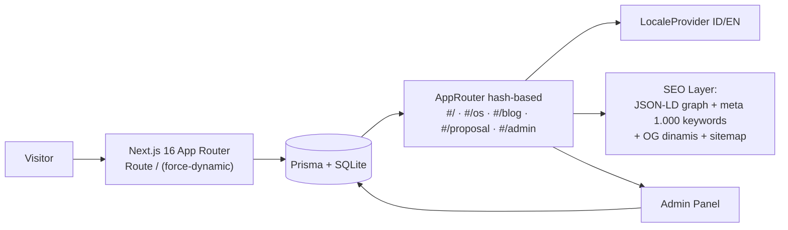

<div align="center">


# ✨ DIGIMAN.ID — Super Website Legalitas & Digitalisasi

### *Naikkan Bisnis Anda ke 7 Lapis Langit Legalitas & Digitalisasi*

**PT Digital Bisnis Manajemen (digiman.id) × PT Top Konsultan Internasional (topkonsultan.web.id)**

*by **Gugun Gunara** · **Muhammad Lutfi Azmi** (prabudanling) · didukung **Santri Angon***

[](https://nextjs.org)
[](https://www.typescriptlang.org)
[](https://tailwindcss.com)
[](https://www.prisma.io)
[](#-seo-god-mode--tier-max)

</div>

---

> 🏛️ **Satu pintu dari akta pendirian sampai transformasi digital.** Landing premium bertema *"7 Lapis Langit"*, sistem standarisasi **Gunara OS (165 dokumen super organisasi)**, blog dwibahasa, studio penawaran otomatis ber-PDF, panel admin, dan **SEO God Mode: 1.000 kata kunci + 1.000 tagar** — semuanya dalam satu aplikasi Next.js 16.

---

## 📖 Daftar Isi

| | | |
|:---|:---|:---|
| [✨ Fitur Superpower](#-fitur-superpower) | [🧬 Gunara OS](#-gunara-os--standarisasi-165-dokumen) | [🔍 SEO God Mode](#-seo-god-mode--tier-max) |
| [👑 Entitas & Kredit](#-entitas--kredit) | [🌐 Jejak Sosial](#-jejak-sosial-resmi) | [🚀 Menjalankan](#-menjalankan-proyek) |
| [🗂 Struktur](#-struktur-proyek) | [🏗 Arsitektur](#-arsitektur-alur-data) | [📜 Riwayat Update](#-riwayat-update-changelog) |

---

## ✨ Fitur Superpower

<div align="center">

| 🏛️ **Landing Premium** | 🌍 **Dwibahasa ID/EN** | 🧬 **Gunara OS Explorer** |
|---|---|---|
| Hero sinematik, marquee elegan, 7 sektor langit, statistik, testimoni, FAQ, CTA — semua dari database. | Toggle bahasa instan pada seluruh antarmuka, persisten antar-kunjungan. | 20 domain × 165 dokumen, 4 tier prioritas (P0–P3), penjelajahan interaktif. |
| 📝 **Blog Dinamis** | 📄 **Proposal Studio** | 🔐 **Panel Admin** |
| Artikel dwibahasa + JSON-LD `BlogPosting`, pembaca elegan, hitung views. | Wizard 4 langkah → penawaran profesional + hitung addon + **Cetak/Simpan PDF A4 penuh**. | Kelola layanan, testimoni, FAQ, kantor, pengaturan, blog & paket Gunara OS. |
| 🤖 **DigiAI Assistant** | 💬 **Integrasi WhatsApp** | 🎨 **Design System** |
| Asisten AI interaktif menjawab pertanyaan legalitas pengunjung. | Setiap CTA tersambung ke WhatsApp resmi dengan pesan terisi otomatis. | Tailwind 4 + shadcn/ui, tema night emerald × gold, motion halus, dark aesthetic. |

</div>

---

## 🧬 Gunara OS — Standarisasi 165 Dokumen

**"Sistem operasi" untuk super organisasi:** 165 dokumen terkurasi dalam **20 domain** manajemen, disusun **4 tier prioritas** — dari fondasi kendali (P0) hingga warisan seabad (P3).

| Paket | Nama | Dokumen | Investasi | Durasi | Cocok Untuk |
|---|---|:---:|---:|:---:|---|
| **PGA-39** | Gunara OS Core | 39 | Rp 39 jt | 6–8 mgg | Fondasi kendali perusahaan |
| **PGA-45** | Gunara OS Bisnis | 45 | Rp 45 jt | 7–9 mgg | Fondasi + mesin pertumbuhan awal |
| **PGA-72** | Gunara OS Pro | 72 | Rp 72 jt | 10–14 mgg | Sistem lengkap skala menengah |
| **PGA-120** | Gunara OS Skala | 120 | Rp 120 jt | 16–22 mgg | Ekspansi multi-unit & kemitraan |
| **PGA-165** | Gunara OS Super Organisasi | 165 | Rp 165 jt | 20–28 mgg | Arsitektur penuh + warisan seabad |

<div align="center">

`🟢 P0 Emeralda — 40 dok` · `🩵 P1 Teal — 40 dok` · `🟡 P2 Amber — 48 dok` · `🏅 P3 Gold — 37 dok`

</div>

---

## 🔍 SEO God Mode — Tier Max

<div align="center">

   

</div>

### 🧠 Korpus 1.000 + 1.000 (`src/lib/seo-keywords.ts`)
Generator **deterministik** (nol randomness → nol hydration error) yang merangkai **48 layanan × 66 kota × 89 long-tail intent × 16 modifier** menjadi:

- 🟩 **1.000 kata kunci** — dari `digiman.id` sampai `biaya pendirian pt jakarta murah` — 250 teratas dipasang di `<meta name="keywords">`, seluruhnya dirender **terlihat** di seksi *Direktori Kata Kunci & Tagar* (induks hidup, bukan spam tersembunyi).
- 🟨 **1.000 tagar sosial** — dari `#DIGIMANID` sampai `#PendirianPerkumpulanSalatiga` — siap panen untuk konten media sosial.
- ✅ Nol duplikat, urut prioritas: **entitas → layanan → long-tail → kombinasi lokal**.

### 🕸️ Entity Graph JSON-LD (`@graph` 7+ node)
`Organization` (DIGIMAN + TopKonsultan) · `Brand` (Santri Angon) · `Person` (Gugun Gunara + Muhammad Lutfi Azmi) · `WebSite` · `ProfessionalService` — **saling terhubung via `@id` + `sameAs` ke 6 profil sosial** → strategi *knowledge panel*.

### ⭐ Rich Result Booster
| Schema | Sumber | Efek di Google |
|---|---|---|
| `FAQPage` | FAQ database | Tanya-jawab terpasang di hasil pencarian |
| `AggregateRating` + `Review` | Testimoni asli | ⭐ Bintang di SERP |
| `ItemList` + `Service` | Katalog layanan | Pemetaan produk-layanan |
| `OfferCatalog` + harga | 5 paket PGA | Informasi investasi terstruktur |
| `BlogPosting` | Setiap artikel blog | Atribusi penulis ganda |

### 🖼️ & 🗺️ Infrastruktur Teknis
- **OG image dinamis 1200×630** — digambar kode (`next/og`), branded penuh, selalu segar.
- `sitemap.xml` dengan **sinyal freshness dari blog terbaru** · `robots.txt` cerdas · PWA `manifest.webmanifest` · metadata lengkap (OG/Twitter card, canonical, keywords, authors).

<div align="center">

> ### 📈 Cara Naik di Google
> **1.** Daftarkan situs di [Google Search Console](https://search.google.com/search-console) → submit `https://digiman.id/sitemap.xml`
> **2.** Minta indexing untuk `https://digiman.id/` (URL Inspection → Request Indexing)
> **3.** Bagikan link (dengan OG card cantik) ke 6 media sosial → crawler mengikuti `sameAs` & membangun entitas

</div>

---

## 👑 Entitas & Kredit

| Entitas | Peran |
|---|---|
| 🏢 **PT Digital Bisnis Manajemen** — [digiman.id](https://digiman.id) | Badan penyelenggara DIGIMAN.ID |
| 🌏 **PT Top Konsultan Internasional** — [topkonsultan.web.id](https://topkonsultan.web.id) | Sponsor & kurasi konsultan |
| 🕌 **Santri Angon** | Komunitas pendukung sistem |
| 👤 **Gugun Gunara** | Pendiri & Direktur Utama |
| 👨‍💻 **Muhammad Lutfi Azmi** (prabudanling) | Arsitek Digital & Pengembang Gunara OS |

```
by Gugun Gunara · Muhammad Lutfi Azmi (prabudanling) · Santri Angon ·
PT Top Konsultan Internasional (topkonsultan.web.id) ·
digiman.id — PT Digital Bisnis Manajemen — support system ini
```

## 🌐 Jejak Sosial Resmi

<div align="center">

[](https://www.facebook.com/bossdanling)
[](https://x.com/gunzz_krenzz)
[](https://www.instagram.com/prabudanling)
[](https://www.tiktok.com/@gunaracorp)
[](https://www.threads.com/@prabudanling)
[](https://www.reddit.com/user/prabudanling/)

</div>

---

## 🚀 Menjalankan Proyek

```bash
# 0. Salin environment variables
cp .env.example .env

# 1. Instal dependensi
bun install

# 2. Siapkan skema database (SQLite + Prisma)
bun run db:push

# 3. Isi data awal (layanan, testimoni, FAQ, 165 dokumen Gunara OS)
bun run db:seed   # scripts/seed-gunara.ts — idempotent

# 4. Jalankan server pengembangan
bun run dev       # → http://localhost:3000

# 5. Kualitas kode
bun run lint      # ESLint — harus exit 0
```

### 🛟 Pemulihan & Backup Database (penting!)

Seluruh isi database diekspor ke `db/backup.json` (teks, ikut di-commit):

```bash
bun run db:backup   # ekspor semua tabel → db/backup.json
bun run db:restore  # pulihkan persis seperti saat backup (hapus + isi ulang)
```

Bila environment baru ter-reset: `bun install && bun run db:push && bun run db:restore` → situs kembali 100% seperti semula.

### 📍 Peta Rute (hash-router dalam satu `/`)

| Rute | Isi |
|---|---|
| `#/` | Landing lengkap 15 seksi + Direktori SEO Hub |
| `#/os` | Penjelajah Gunara OS — 20 domain × 165 dokumen |
| `#/blog` · `#/blog/{slug}` | Indeks & pembaca artikel dwibahasa |
| `#/proposal` | Studio penawaran + ekspor PDF |
| `#/admin` | Panel admin + Analytics Mission Control |
| `#/dashboard` | ⭐ **Portal Klien** — dashboard futuristik 30 fitur premium |

<details>
<summary>🔐 <b>Akses Panel Admin</b> (klik untuk membuka)</summary>

&nbsp;&nbsp;• URL: `https://digiman.id/#/admin`
&nbsp;&nbsp;• Password default: tercatat pada tabel `SiteSetting` database (nilai awal `gunara165`) — **segera ganti setelah go-live**.
&nbsp;&nbsp;• Sesi disimpan pada cookie aman `gunara_admin`.

</details>

---

## 🗂 Struktur Proyek

```
digiman.id/
├── 📂 prisma/                    # Skema database (SQLite)
├── 📂 db/                        # File database (regenerasi: db:push + db:seed)
├── 📂 scripts/                   # Seed 165 dokumen + seed dashboard + parser PGA
├── 📂 docs/                      # Banner README + arsitektur master PGA-165
├── 📂 public/                    # Logo, artwork, robots.txt
├── 📄 .env.example               # Template environment variables
└── 📂 src/
    ├── 📂 app/
    │   ├── layout.tsx            # Metadata global + JSON-LD entity graph
    │   ├── page.tsx              # Server data + FAQPage/Review/ItemList JSON-LD
    │   ├── globals.css           # Tema night emerald × gold + animasi
    │   ├── sitemap.ts            # /sitemap.xml (freshness dari blog)
    │   ├── manifest.ts           # PWA manifest
    │   └── opengraph-image.tsx   # OG card dinamis 1200×630 (next/og)
    ├── 📂 lib/
    │   ├── brand.ts              # Sumber tunggal identitas & sosial
    │   ├── seo-keywords.ts       # 🔥 Korpus 1.000 kata kunci + 1.000 tagar
    │   ├── i18n.tsx              # LocaleProvider ID/EN
    │   ├── gunara.ts             # Logika Gunara OS & paket
    │   ├── proposal-calc.ts      # Kalkulator penawaran + addon
    │   └── admin-auth.ts         # Auth cookie admin
    └── 📂 components/
        ├── 📂 digiman/           # Landing: hero, marquee, stats, services,
        │                         # paket, os-teaser, testimonials, blog-teaser,
        │                         # faq, seo-hub ⭐, cta, contact, footer, dst.
        ├── 📂 dashboard/         # ⭐ Portal Klien (30 fitur premium)
        ├── 📂 gunara/            # OS explorer + teaser
        ├── 📂 blog/              # Index + reader
        ├── 📂 proposal/          # Studio wizard + preview print-perfect
        └── 📂 admin/             # Panel admin lengkap
```

## 🏗 Arsitektur (Alur Data)



---

## 📜 Riwayat Update (Changelog)

| # | Upgrade | Status |
|:---:|---|:---:|
| 1 | Fondasi Next.js 16 + Prisma + seed database | ✅ |
| 2 | Landing premium "7 Lapis Langit" multi-seksi dari database | ✅ |
| 3 | Sistem i18n ID/EN + persistensi preferensi | ✅ |
| 4 | **Gunara OS** — 20 domain × 165 dokumen × 4 tier + 5 paket PGA | ✅ |
| 5 | Blog dinamis dwibahasa + pembaca artikel | ✅ |
| 6 | Proposal Studio — wizard, kalkulator addon, penawaran | ✅ |
| 7 | Panel Admin penuh (layanan, testimoni, FAQ, kantor, blog, paket) | ✅ |
| 8 | DigiAI Assistant + integrasi WhatsApp | ✅ |
| 9 | Fix hydration (timezone WIB) + **PDF A4 sempurna** (print CSS overhaul) | ✅ |
| 10 | **Branding & Entity SEO** — JSON-LD graph 7 entitas, footer kredit, 6 sosial, sitemap, manifest, robots | ✅ |
| 11 | Marquee diperlambat ke zona premium (120s/150s) + aksesibilitas `prefers-reduced-motion` | ✅ |
| 12 | 🔥 **SEO GOD MODE TIER MAX** — korpus 1.000 kata kunci + 1.000 tagar, SEO Hub dirender, FAQPage + Review + ItemList JSON-LD, OG image dinamis, sitemap freshness, README mahakarya ini | ✅ |
| 13 | Tombol "Unduh Kode Sumber" di footer + snapshot zip — *dihapus kembali di #18* | ↩️ |
| 14 | 🧹 **Repo Hygiene siap-GitHub** — untrack `.env`/db binary/sampah sandbox, `.gitignore` diperkuat, `.env.example`, `db:seed`, dokumen master PGA-165 → `docs/` | ✅ |
| 15 | 🚀 **DASHBOARD ERA** — **Portal Klien futuristik `#/dashboard` (30 fitur premium)**: command palette ⌘K, jam WIB live, progress ring 165 dok, health score, milestone timeline, invoice + grafik pembayaran, chat tim, achievements, OKR tracker, print/PDF, dark/light, ID/EN — **+ Admin Analytics "Mission Control"**: KPI pendapatan real-time, 3 grafik recharts, feed aktivitas klien. Skema baru `ClientProject`/`Invoice`/`ActivityEvent`/`Meeting` + seed + API | ✅ |
| 16 | 🛟 **Sistem Backup/Restore Database** — `db:backup`/`db:restore`, `db/backup.json` di-commit, pemulihan bencana anti-reset-sandbox | ✅ |
| 17 | 🏛 **LEGACY 17 TAHUN** — timeline "Legalitas Kami Muda. Keahlian Kami 17 Tahun.": McKinsey & Company 2009 → praktik independen 2013 → PT 2022 → era digiman.id; badge hero, stat 17+ tahun, JSON-LD foundingDate + bio pendiri, DigiAI cerdas sejarah | ✅ |
| 18 | 🗑️ **Siap-GitHub Murni** — tombol unduh kode sumber dihapus dari footer (diganti badge resmi → repo GitHub), snapshot zip & script `zip:source` dihapus dari repo | ✅ |

---

## ✅ Jaminan Kualitas

- 🧪 TypeScript `strict` — `tsc --noEmit` bersih pada seluruh `src/`
- 🧹 ESLint exit 0
- 🖥️ Terverifikasi end-to-end dengan browser automation: render, interaksi, PDF, JSON-LD, responsivitas mobile/desktop
- 🦴 Bebas hydration mismatch (semua tanggal dipatok `Asia/Jakarta`, korpus SEO deterministik)
- ♿ Aksesibilitas: semantik HTML, ARIA, `prefers-reduced-motion`, target sentuh ≥44px

---

<div align="center">

> *"Legalitas adalah tangganya, digitalisasi adalah sayapnya —*
> *biarkan bisnismu naik ke 7 lapis langit."*

**— Gugun Gunara, Pendiri DIGIMAN.ID**


**Made with 🔥 by Muhammad Lutfi Azmi (prabudanling) · Powered by Gunara OS**

</div>
